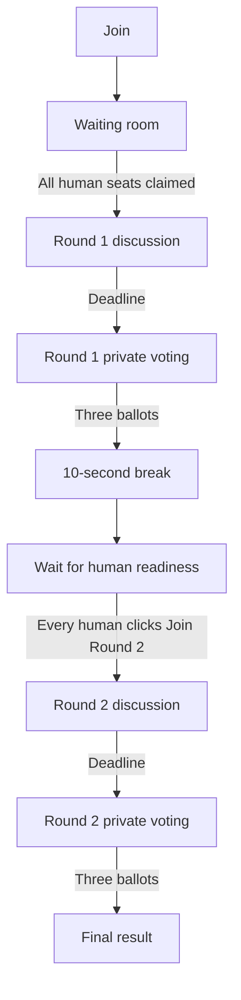
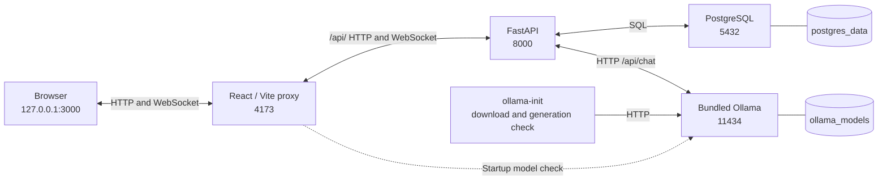

# Decision Study


A local CHM demo in which three anonymous participants discuss and vote in two rounds to choose a Decision Maker. The subsequent experiment is imaginary, so the application ends at the result. The stack is React, Python FastAPI, PostgreSQL, Docker Compose, and Ollama.

## Quick start

Install Docker with Linux containers and Docker Compose v2.24.4 or newer. From the checkout, run the entire reviewer setup with one command.

```sh
docker compose up --build
```

**Open [http://127.0.0.1:3000/](http://127.0.0.1:3000/).**

The default model is **`qwen3:1.7b`**. Docker supplies Ollama and the application dependencies. First startup needs internet access for images and the approximately **1.4 GB** model download. Download duration depends on the connection and machine.

The initialization log shows `Downloading qwen3:1.7b` or `Using cached qwen3:1.7b`, then `Ready: qwen3:1.7b` after generation succeeds. Wait for the frontend's final message.

```text
Application ready
Open http://127.0.0.1:3000/
```

That message follows checks of the page, backend/database health, and a real model reply. The `ollama_models` and `postgres_data` volumes preserve downloaded models and session data. Stop the stack while retaining both with `docker compose down`.

Both startup modes use the same Compose project, `chm-review-verify`, so switching models preserves the database and saved results.

| Startup command | Model and source |
| --- | --- |
| `docker compose up --build` | Bundled Ollama, `qwen3:1.7b`; downloads it once if absent, then reuses the cache |
| `docker compose -p chm-review-verify up --build` | The same reviewer setup and Qwen model; `-p` selects the project name, not a model |
| `docker compose -f compose.yml -f compose.ollama.yml up --build` | Windows Ollama, installed `llama3:latest` by default; no bundled model download |

All three serve [http://127.0.0.1:3000/](http://127.0.0.1:3000/). Windows mode requires its host Ollama server to be running, or use the helper below. Only that override accepts `OLLAMA_BASE_URL` and `OLLAMA_MODEL` from your environment or `.env`; the reviewer model is fixed in the base Compose configuration. First-time downloads require working internet/registry access and sufficient disk space and memory; startup reports an actionable error if its bounded retries fail.

See [troubleshooting](docs/troubleshooting.md) for startup failures and operational details.

## Try the experiment

1. Open an independent browser tab for each human and click **Join study**. Neutral Player A/B/C labels are assigned independently of participant type. Public state omits player types, other players' tokens, and ballots.
2. Wait until all required human seats are claimed. AI seats are filled automatically. The checked-in configuration uses three humans; with `[human, ai, ai]`, discussion starts when the one human joins.
3. Chat during Round 1, then submit one private vote for any player, including yourself. Voting waits for all three ballots.
4. Watch **Round 1 discussion and voting complete** and the shared **10-second break**. Afterward, every human clicks **Join Round 2**. AI readiness requires no click.
5. Discuss and vote again. Everyone receives the final Decision Maker, aggregate totals, and deciding rule.

Intermediate feedback consists of your own vote acknowledgement and shared round completion. Round 1 totals and a provisional winner are withheld.



Refresh or reconnection with the tab's token restores its seat and state. Tokens use `sessionStorage`, which ordinary tab closure may discard. When all humans disconnect, an unfinished session has a 15-second reconnect grace before abandonment. Completed and abandoned records remain stored, and fresh joins can form another group. A completed session's token retrieves its saved result.

## Participant configuration

Edit [config.yml](config.yml), then apply it with `docker compose restart backend`.

```yaml
participants: [human, human, human]
discussion_seconds: 60
```

| Participants | Humans to join |
| --- | ---: |
| `[human, human, human]` | 3 |
| `[human, human, ai]` | 2 |
| `[human, ai, ai]` | 1 |

The server validates these compositions in any order and a positive 32-bit integer duration. It reads YAML at backend startup. A session snapshots its settings when its first participant joins. Finish the current session or let it be abandoned before testing changed settings.

The discussion duration is editable in the same YAML. For example, `discussion_seconds: 100` starts **each discussion round at 1:40**. The browser formats the server-owned deadline as minutes and seconds; voting starts when that deadline is reached. The separate Round 1 break remains 10 seconds.

After changing the YAML, restart the backend with the command for your active startup mode, then join a new session:

```powershell
# Reviewer mode
docker compose restart backend

# Windows Ollama mode
docker compose -f compose.yml -f compose.ollama.yml restart backend
```

An existing session keeps the participants and duration it started with.

Open tabs independently through the address bar, or use separate browser profiles. Duplicating or restoring a tab can copy its token and recover an existing seat.

## Architecture



The diagram shows the default setup. Only frontend port 3000 is published. React sends admission requests and WebSocket actions through the frontend proxy. FastAPI owns identity, phases, deadlines, validation, and publication. PostgreSQL stores sessions, players, messages, ballots, readiness, and results. The frontend server also probes Ollama during startup.

The main boundaries are [transport](backend/app/main.py), [experiment logic](backend/app/experiment.py), [persistence](backend/app/db.py), and the [model adapter](backend/app/llm_player.py). The optional Windows setup below replaces the bundled model target with host Ollama.

## AI participant design

**Server scheduling → model generation → server validation → persistence and broadcast.**

One reusable `LLMPlayer` implementation serves each AI seat through separate calls with its own label and ballot. Calls run sequentially against the same model. Their shared memory is saved public chat.

FastAPI schedules human replies and optional spontaneous turns. A named question stays with its recipient across reply, opening, and idle paths. A general message gets a primary responder; explicit group requests can offer both AIs a turn. An unusable unaddressed reply can give the other AI one opportunity. Initial speaker order is randomized, and Round 2 gives humans nine seconds to lead before an optional opening. Human input interrupts optional chatter. Distinct follow-ups remain queued, newest next, with at most six pending required turns. A human message allows one later idle contribution; AI posts do not re-arm it, so bot-to-bot exchanges stay bounded. Optional turns can remain silent.

Each discussion call receives its label, current round, remaining-time snapshot, a bounded recent current-round transcript, and the selected message when applicable. Voting can also use earlier public discussion. Private ballots, participant types, and tokens are excluded. Round changes cancel pending work, and publication rechecks the round, phase, and deadline.

The study instructions explicitly state that only discussion and private voting have occurred; there is no observed game, task performance, or history of moves to evaluate. Timing metadata is for pacing a reply, not a candidate-quality criterion or a number to repeat in chat. A generated countdown reading is rejected and can regenerate once. The browser continues to show the server-owned countdown.

Discussion uses native model conversation turns: that seat's own public lines are assistant messages, and other players' labelled lines are user messages. The selected player's actual message goes last. One compact instruction describes identity, the study, grounding, privacy, and time; there are no topic-specific reply scripts, canned chat fallbacks, or synthetic player messages. Each AI receives its own view without learning the other players' types. Earlier AI replies are used only to check repetition, not supplied as earlier-round discussion memory.

Ollama calls have a 30-second maximum, shortened for discussion deadlines; optional idle turns have up to 15 seconds. Invalid discussion output can regenerate once within the same budget; optional `PASS` is respected. Replies normally use one to three short sentences, with a 192-token generation allowance instead of a fixed 22-word limit. Chat sampling permits variation. Filters reject self-narration, named ballot choices (including self-selection announcements), false voting-eligibility claims, echoes, and substantial near-verbatim repetition; they do not establish factual accuracy. The shared privacy/rules check runs again before saving AI chat, and filters invalid historical AI lines when loading public transcripts without deleting the audit records. Self-voting remains legal in the private ballot. Failed chat is logged as `source=none` and stays silent. A failed AI ballot uses a valid uniform random A/B/C fallback, logged as `source=fallback`. Published model chat and votes use `source=model`. Deadlines can still cut off late requests.

## Voting and winner selection

Each AI receives a separate voting request about concrete contributions and group engagement. These requests hide the voter's identity and assign fresh private P1/P2/P3 identifiers to the candidates, including references inside the chat. The model must return exactly one eligible `candidate` field. FastAPI validates and maps it back to A/B/C; all three players, including the voter, remain eligible. Human and AI ballots share phase checks and database uniqueness rules. Hiding ownership and randomizing identifiers reduce specific label and self-selection cues; they do not prove the models are unbiased.

Voting evidence is selected from all eligible public messages with equal byte reservations per player and included round, retaining initial and recent contributions when they fit. Unused space goes first to less represented groups. Complete original messages remain in chronological order; no model-generated summary replaces them. The request identifies a truncated transcript as an excerpt, and the criteria warn against rewarding message volume, confident claims, or unsupported game performance. The finite budget can still omit a long contribution. The model returns a candidate rather than per-player scores or a stored explanation, so individual vote reasoning remains unverified. See [vote_context.py](backend/app/vote_context.py).

The [election function](backend/app/election.py) narrows candidates in this order.

1. Highest received votes across both rounds.
2. Highest Round 2 received votes among those tied.
3. Highest received votes from other players across both rounds among those still tied.
4. Uniform `secrets.choice` among the remaining unique labels.

Self-votes count in steps 1 and 2. Individual ballots stay private. Finalization uses a transaction and session row lock, storing one winner, deciding rule, and aggregate totals. Refreshing a completed result reuses that stored outcome.

## Design decisions and limitations

One active session and one FastAPI process keep coordination small. Persistent deadlines and results support recovery; pending AI reply opportunities are held in memory and are not durably replayed after a backend restart. Local models avoid API credentials but require downloads, memory, and inference time. Human voting has no timeout. Output filters detect common echoes, vote announcements, and normalized duplicates, but cannot guarantee natural, grounded, or unbiased conversation. Two seats using the same model can make similar choices.

## Tests and AI usage

See the [live agent verification record](docs/agent-verification.md) for the two-model checks, observed limitations, and commands run.

Developer checks require Python 3.12 with the backend dependencies, and Node.js 22. From the repository root, run backend tests with mocked providers and controlled ballots.

```sh
cd backend
python -m pip install -r requirements.txt
python -m unittest discover -s tests -v
```

From the repository root, run the frontend readiness tests.

```sh
node --test frontend/startup-ready.test.mjs
```

Tests cover election rules, privacy, break/readiness, scheduling, request construction, and failures. Unit tests do not establish live model quality or fresh-machine startup reliability. [Runtime log checks](docs/troubleshooting.md#verify-live-ai-actions) support manual verification.

[ai_prompts.md](ai_prompts.md) contains **selected** ChatGPT and Codex entries with author-reported tool/model details. ChatGPT prompts were edited for clarity. This is incomplete against the assessment's requirement for **all prompts**. The complete original prompt history and any missing exact tool/model details remain a submission gap. Runtime prompt templates are in the model adapter.

## Optional Windows Ollama

For this Windows laptop, the helper starts the installed Ollama server if it is stopped, checks that `llama3:latest` is already installed, then runs the Docker override. It does not download models or change persistent Windows settings. Run it from PowerShell:

```powershell
.\start-demo.ps1
```

**Open [http://127.0.0.1:3000/](http://127.0.0.1:3000/).**

If Windows Ollama is already running, the equivalent direct Docker command is:

```powershell
docker compose -f compose.yml -f compose.ollama.yml up --build
```

**Open [http://127.0.0.1:3000/](http://127.0.0.1:3000/).**

This mode uses `host.docker.internal:11434` and the installed model. Bundled Ollama and its initialization service are excluded. Wait for `Application ready` after the frontend verifies a model reply. [Environment overrides and restart commands](docs/troubleshooting.md#windows-ollama).
